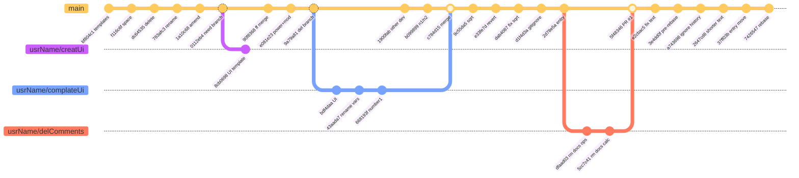

<div align="center">

# 🧮 gitLearn

### ماشین‌حساب پایتونی که برای یاد دادن **Git** ساخته شده؛ نه برای حساب کردن!


**تاریخچه‌ی پر از ماجرا · هر کامیت یک درس**


</div>

---

<div dir="rtl" align="right">
       
⚠️ برای یادگیری و فهم Git و این Repository اول باید این دوتا ویدیو رو ببینید. بعدش برای درک عمیق و یادگیری کامل به همین صفحه مراجعه کرده و با دقت مطالب رو بخونید. در غیر این صورت این Repository کمکی به شما نخواهد کرد


[جلسه اول](https://www.aparat.com/v/srf2aeg)

[جلسه دوم](https://www.aparat.com/v/srf2aeg)


### ترتیب استفاده از مطالب کارگاه:

1-ویدیو های ضبط شده کارگاه

2-[جزوه مکمل  کارگاه](https://github.com/Shahed-CE-Association/gitLearn/blob/main/src/git_github_workshop_gitLearn.ipynb)

3-برسی لاگ و تاریخچه این Repository بر اساس متن هایی که در ادامه اومدن

4-مرور و تثبیت مطالب با [WorkFlow](https://github.com/Shahed-CE-Association/gitLearn/blob/main/src/WorkFlow.pdf)<span style="font-size:4px">(برای مشاهده و استفاده باید روی آیکون دانلود بزنید چون گیتهاب pdf رو نمایش نمیده )</span></div>


<div dir="rtl">

## 📖 این پروژه چیه؟

<div dir="rtl" align="right">
       
`gitLearn` یک ماشین‌حساب ساده‌ی ترمینالی با پایتونه، ولی **کد، فرعیِ ماجراست**. هدف اصلی این ریپو آموزش عملی Git در کارگاه انجمن مهندسی کامپیوتر شاهد (Shahed CE Association) است. تاریخچه‌ی کامیت‌ها طوری طراحی شده که تقریباً **همه‌ی سناریوهای واقعی Git** توش اتفاق بیفته:

</div>

`init → commit → rename → amend → branch → fast-forward merge → branch delete → merge conflict → revert → .gitignore → Pull Request → rebase`

برای یادگیری  Git و نحوه کارکردن با اون، پیشنهاد میشه که کد فقط یک بار اجرا بشه و بعد به بخش **«🕰️ داستان کامیت‌ها»** یا `git log`بریم.

## ✨ قابلیت‌های ماشین‌حساب

| # | عملیات | نماد | نکته |
|:-:|--------|:----:|------|
| ۱ | جمع | `+` | |
| ۲ | تفریق | `-` | |
| ۳ | ضرب | `*` | |
| ۴ | تقسیم | `/` | تقسیم بر صفر خطای شفاف می‌دهد، برنامه کرش نمی‌کند |
| ۵ | توان | `^` | با `**` پیاده‌سازی شده |
| ۶ | باقی‌مانده | `%` | باقی‌مانده بر صفر هم مدیریت شده |
| ۷ | جذر | `√` | جذر عدد منفی خطای واضح می‌دهد |
| ۸ | خروج | | |

بقیه‌ی امکانات:

- 🛡️ **اعتبارسنجی ورودی:** اگه به‌جای عدد، متن وارد شود برنامه در پیام خطا می‌افتد و دوباره منو را نشان می‌دهد.
- 📝 **تاریخچه‌ی محاسبات:** هر عملیات در `history.txt` ذخیره می‌شود. این فایل عمداً توی `.gitignore` است تا یاد بگیریم فایل‌های موقت را کامیت نکنیم.
- 🎨 **منوی تمیز ترمینالی** با ایموجی.

</div>

##  اجرا

```bash
git clone https://github.com/Shahed-CE-Association/gitLearn.git
cd gitLearn
python calucator.py
```

> فقط پایتون ۳ لازم است؛ هیچ پکیج خارجی‌ای نصب نمی‌شود.

نمونه‌ی خروجی:

```text
Welcome!
press any key to use magical calucator

========================================
       🧮 Advanced Python Calculator
========================================
1. Addition (+)
2. Subtraction (-)
3. Multiplication (*)
4. Division (/)
5. Power (^)
6. Modulus (%)
7. Square Root (√)
8. Exit
========================================
Please select an option (1-8): 4
Enter the first number: 10
Enter the second number: 0
✅ Result: Error: Division by zero is not allowed!
```

<div dir="rtl">

## 🗂️ ساختار پروژه

</div>

```text
gitLearn/
├── calucator.py     # رابط کاربری ترمینالی (منو، ورودی، تاریخچه)
├── operations.py    # منطق ریاضی؛ جدا از UI
└── .gitignore       # __pycache__/ و history.txt
```

<div dir="rtl">

>  عمداً منطق (`operations.py`) از رابط کاربری (`calucator.py`) جدا شده تا چند نفر بتوانند هم‌زمان روی دو فایل کار کنند و با هم conflict نگیرند؛ دقیقاً همان چیزی که توی کارگاه تمرین شد.

---

##  نقشه‌ی شاخه‌ها (Branch Graph)

ساختار تاریخچه به شکل گراف:

</div>



<div dir="rtl">

<div dir="rtl" align="right">

> <span dir="rtl" align="right">   برخی شاخه‌ها (مثل `usrName/creatUi`) بعد از ادغام حذف شدند و فقط روی گراف می‌بینیم‌شان. شاخه‌های `complateUi`، `delComments` و `editCalucator` هنوز روی remote موجودند. بعد از rebase هم تاریخچه‌ی `editCalucator` خطی شد؛ پس گراف بالا بعد از آن، یک خط راست است. </span>

</div>
---

##  داستان کامیت‌ها 

مجموع **۳۰ کامیت** (۲۸ کامیت عادی + ۲ مرج)  برای خوانایی به ۶ فصل تقسیم شده‌اند. روی هش هر کامیت بزنیم مستقیم به صفحه‌ی آن می رویم.

###  فصل ۱ · شروع ماجرا : ساخت و ویرایش اولیه

| هش | پیام کامیت | چه اتفاقی افتاد؟ | درس Git |
|----|-----------|------------------|---------|
| [`bf804c1`](https://github.com/Shahed-CE-Association/gitLearn/commit/bf804c1) | Add templates for operation and calucator | دو فایل خالی `operation.py` و `calucator.py` ساخته شد؛ اسکلت پروژه. | `git add` / `git commit` |
| [`f116c6f`](https://github.com/Shahed-CE-Association/gitLearn/commit/f116c6f) | Add some space to change operation file | یک فاصله‌ی خالی به `operation.py` اضافه شد، فقط برای اینکه تغییر ایجاد شود و بتوانیم diff ببینیم. | `git diff` / `git status` |
| [`dc64535`](https://github.com/Shahed-CE-Association/gitLearn/commit/dc64535) | Delete calucator file... | فایل `calucator.py` حذف شد (چون فعلاً لازم نبود). | `git rm` |
| [`783afc3`](https://github.com/Shahed-CE-Association/gitLearn/commit/783afc3) | Rename operation file | `operation.py` شد `operations.py`. گیت این را به‌عنوان **rename** تشخیص می‌دهد، نه حذف و ساخت دوباره، و تاریخچه‌ی فایل حفظ می‌شود. | `git mv` |

###  فصل ۲ · توسعه، amend 

| هش | پیام کامیت | چه اتفاقی افتاد؟ | درس Git |
|----|-----------|------------------|---------|
| [`1a10c68`](https://github.com/Shahed-CE-Association/gitLearn/commit/1a10c68) | Add some function (before --amend...) | توابع `add`، `subtract`، `multiply` و `divide` (با مدیریت تقسیم بر صفر) نوشته شد. پیام اولیه‌ی کامیت `Add some func` بود و با amend اصلاح شد (خود پیام همین را می‌گوید). | `git commit --amend` |
| [`0112eb4`](https://github.com/Shahed-CE-Association/gitLearn/commit/0112eb4) | I want to add power & modulus... but suddenly need to create a branch | وسط نوشتن `power` و `modulus` یک کار فوری پیش آمد؛ این کامیت نقطه‌ی انشعاب بود. | کار نیمه‌کاره و نیاز به branch |
| [`8cb0698`](https://github.com/Shahed-CE-Association/gitLearn/commit/8cb0698) | Add template for calucator in new branch | روی شاخه‌ی جدید `usrName/creatUi` فایل `calucator.py` (اسکلت UI) دوباره ساخته شد. | `git switch -c` / `git checkout -b` |
| [`90f8368`](https://github.com/Shahed-CE-Association/gitLearn/commit/90f8368) | Merge usrName/creatUi branch to master (fast forward) | شاخه‌ی UI به `main` رسید. چون `main` در این فاصله جلو نرفته بود، مرج از نوع **fast-forward** بود: بدون merge commit و با تاریخچه‌ی خطی. | `git merge` (fast-forward) |
| [`e081e23`](https://github.com/Shahed-CE-Association/gitLearn/commit/e081e23) | Now we finished suddenly mission, complete operation's functions | کار فوری تمام شد و برگشتیم سر کار اصلی: توابع `power` و `modulus` (با مدیریت صفر) اضافه شدند. | برگشت به کار قبلی |
| [`9a79a81`](https://github.com/Shahed-CE-Association/gitLearn/commit/9a79a81) | Delete usrName/createUi because no more needed | شاخه‌ی تمام‌شده پاکسازی شد. (در `operations.py` هم یک تغییر کوچک فاصله ثبت شده.) | `git branch -d` |

###  فصل ۳ · conflict و   Merge Conflict

| هش | پیام کامیت | چه اتفاقی افتاد؟ | درس Git |
|----|-----------|------------------|---------|
| [`1900fab`](https://github.com/Shahed-CE-Association/gitLearn/commit/1900fab) | Another person wants to complete calucator | روی `main`، «نفر دوم» فایل `calucator.py` را کامل (۸۶ خط) نوشت. | کار هم‌زمان |
| [`b099899`](https://github.com/Shahed-CE-Association/gitLearn/commit/b099899) | Change num1 & num2 -> n1 & n2 | روی `main` نام متغیرها به `n1` و `n2` تغییر کرد (۱۷ خط). | تغییر در همان خطوط |
| [`bdf4daa`](https://github.com/Shahed-CE-Association/gitLearn/commit/bdf4daa) | Complete calucator file for ui | روی شاخه‌ی `usrName/complateUi`، همان فایل با نسخه‌ی خودش کامل شد (۸۶ خط). | شاخه‌ی موازی |
| [`43aada7`](https://github.com/Shahed-CE-Association/gitLearn/commit/43aada7) | we gonna change variable's name | کامیت آماده‌سازی برای تغییر نام متغیرها در شاخه. | |
| [`668193f`](https://github.com/Shahed-CE-Association/gitLearn/commit/668193f) | Change num1 & num2 -> number1 & number2 | همان خطوط روی شاخه به `number1` و `number2` تغییر کرد. | دو نام متفاوت برای یک متغیر |
| [`c784d15`](https://github.com/Shahed-CE-Association/gitLearn/commit/c784d15) | Merge branch 'usrName/complateUi' | **مرج واقعی** با merge commit . چون هر دو طرف همان خطوط را عوض کرده بودند، باید conflict دستی حل می‌شد. نتیجه‌ی نهایی: نام‌های `number1`/`number2`. | `git merge` + حل conflict |

###  فصل ۴ · Revert

| هش | پیام کامیت | چه اتفاقی افتاد؟ | درس Git |
|----|-----------|------------------|---------|
| [`9c55da5`](https://github.com/Shahed-CE-Association/gitLearn/commit/9c55da5) | Add square_root function to operation file | تابع `square_root` فقط به‌صورت ناقص (تعریف + docstring بدون بدنه) کامیت شد. | کامیت زودهنگام |
| [`e33fe7d`](https://github.com/Shahed-CE-Association/gitLearn/commit/e33fe7d) | Revert "Add square_root function..." | به‌جای حذف تاریخچه، یک کامیت جدید که اثر کامیت قبلی را **خنثی** می‌کند. روش امن برای کدی که قبلاً push شده. | `git revert` |
| [`dab4087`](https://github.com/Shahed-CE-Association/gitLearn/commit/dab4087) | We revert to last state and Now correct it | این بار درست نوشتیم: `square_root` با بررسی عدد منفی و خطای مناسب. | اصلاح بعد از revert |

###  فصل ۵ · کار با GitHub: ignore، PR و Merge 

| هش | پیام کامیت | چه اتفاقی افتاد؟ | درس Git |
|----|-----------|------------------|---------|
| [`d1f4d3a`](https://github.com/Shahed-CE-Association/gitLearn/commit/d1f4d3a) | add gitignore for extra file and send to server | فایل `.gitignore` با `__pycache__/` ساخته شد و برای اولین بار به سرور (GitHub) فرستاده شد. | `.gitignore` / `git push` |
| [`2d78e5a`](https://github.com/Shahed-CE-Association/gitLearn/commit/2d78e5a) | Add an entry to use project | یک صفحه‌ی خوش‌آمد («press any key to use magical calucator») قبل از منو اضافه شد. | |
| [`dfaad03`](https://github.com/Shahed-CE-Association/gitLearn/commit/dfaad03) | Delete comments from operations file | روی شاخه‌ی `usrName/delComments`، ۱۰ خط کامنت و docstring از `operations.py` پاک شد. | کار روی branch جدا |
| [`5cc7c41`](https://github.com/Shahed-CE-Association/gitLearn/commit/5cc7c41) | Delete comments from calucator file | ۴ خط کامنت از `calucator.py` هم پاک شد. | |
| [`5f48346`](https://github.com/Shahed-CE-Association/gitLearn/commit/5f48346) | Merge pull request #1 from Mohsen-A-F/usrName/delComments | **اولین Pull Request** روی خود GitHub مرج شد. | Pull Request |
| [`e2cbac5`](https://github.com/Shahed-CE-Association/gitLearn/commit/e2cbac5) | In last commit we merged branch with main, with PR in github we didn't do: `git merge ...` `git push` | درس مهم: وقتی مرج را روی GitHub (PR) انجام می‌دهیم، دیگر لازم نیست `git merge` و `git push` را دستی بزنیم؛ فقط باید `git pull` کنیم. در همین کامیت هم متن ورودی از «Hi! press any key...» به «press any key...» تغییر کرد. | PR در مقابل merge محلی |

###  فصل ۶ ·در پایان Rebase

| هش | پیام کامیت | چه اتفاقی افتاد؟ | درس Git |
|----|-----------|------------------|---------|
| [`3e4dd0f`](https://github.com/Shahed-CE-Association/gitLearn/commit/3e4dd0f) | Now we wanna do rebase | یک تغییر کوچک (حذف فاصله‌ی انتهای فایل) روی `main`، آماده‌سازی برای تمرین rebase. | |
| [`a743698`](https://github.com/Shahed-CE-Association/gitLearn/commit/a743698) | Add history file to git ignore | `history.txt` به `.gitignore` اضافه شد تا لاگ محاسبات کامیت نشود. | `.gitignore` |
| [`2647cd8`](https://github.com/Shahed-CE-Association/gitLearn/commit/2647cd8) | Delete some extra texts in output | متن‌های خروجی کوتاه شد: «Welcome to the Git Workshop Calculator!» → «Welcome!» و «Exiting application...» → «Bye. Have a great day!» | |
| [`37ff03b`](https://github.com/Shahed-CE-Association/gitLearn/commit/37ff03b) | Change entry to the correct place | صفحه‌ی ورودی از `print_menu()` به‌جای درستش یعنی `main()` منتقل شد (۶۶ خط تغییر؛ بیشتر به‌خاطر indentation). این کامیت روی شاخه‌ی `usrName/editCalucator` بود. | تغییر ساختار |
| [`7426547`](https://github.com/Shahed-CE-Association/gitLearn/commit/7426547) | we did rebase. | 🎉 **فینال!** کامیت‌های شاخه روی نوک `main` بازنویسی شدند و تاریخچه کاملاً **خطی** شد، بدون merge commit اضافه. | `git rebase` |

---

##  خلاصه‌ی مفاهیم Git که تا اینجا استفاده شده

| مفهوم | کجا؟ | دستور اصلی |
|-------|------|------------|
| ساخت و ثبت تغییرات | `bf804c1`, `f116c6f` | `git add`, `git commit` |
| حذف و تغییر نام فایل | `dc64535`, `783afc3` | `git rm`, `git mv` |
| اصلاح آخرین کامیت | `1a10c68` | `git commit --amend` |
| ساخت و حذف شاخه | `8cb0698`, `9a79a81` | `git switch -c`, `git branch -d` |
| ادغام fast-forward | `90f8368` | `git merge` |
| ادغام با merge commit و conflict | `c784d15` | `git merge` + حل دستی |
| خنثی‌سازی کامیت | `e33fe7d` | `git revert` |
| نادیده گرفتن فایل‌ها | `d1f4d3a`, `a743698` | `.gitignore` |
| Pull Request | `5f48346` | GitHub PR |
| بازنویسی تاریخچه | `7426547` | `git rebase` |

##  دستورهای کاربردی برای دیدن خود تاریخچه

</div>

```bash
# گراف کامل شاخه‌ها
git log --all --graph --oneline --decorate

# فقط کامیت‌های مرج
git log --merges --oneline

# تغییرات یک کامیت مشخص
git show c784d15

# تاریخچه‌ی یک فایل (حتی بعد از rename)
git log --follow --oneline operations.py
```

<div dir="rtl">

## 🧪 چند نکته‌ درباره پروژه و کد

-  از اونجایی که هدف پروژه یادگیری git بوده، دقت روی بهینه نوشتن نبوده به ختطر همین شرط `if entry != " "` یعنی فقط وقتی کاربر **دقیقاً یک فاصله** وارد کند برنامه بسته می‌شود. هر چیز دیگری (حتی خالی) منو را باز می‌کند.
-  اسم فایل `calucator.py` غلط املایی دارد (`calculator`)؛ این ریپو آموزشی است و تغییر نام فایل می‌تواند تمرین خوبی برای `git mv` باشد.
-  دو کامیت `1900fab` و `bdf4daa` تقریباً همان ۸۶ خط را به‌صورت موازی اضافه کرده‌اند و باعث ایجاد conflict شده‌اند.

## 🤝 مشارکت (Contributing)

دوست داری کمک کنی؟ آقا عالی!

</div>

```bash
# 1. فورک و کلون
git clone https://github.com/<your-username>/gitLearn.git
cd gitLearn

# 2. شاخه‌ی جدید با الگوی <username>/<feature>
git switch -c yourName/myFeature

# 3. تغییر بده و کامیت کن (با پیام واضح!)
git add .
git commit -m "Add: short and clear description"

# 4. بفرست و PR بزن
git push -u origin yourName/myFeature
```

<div dir="rtl">

ایده‌های شروع:

- [ ] اضافه کردن تست‌های `unittest` برای `operations.py`
- [ ] نمایش تاریخچه‌ی محاسبات در منو (گزینه‌ی «History»)
- [ ] اصلاح نام فایل `calucator.py` ← `calculator.py`
- [ ] اضافه کردن عملیات‌های جدید (فاکتوریل، لگاریتم، ...)
- [ ] ترجمه‌ی منو به فارسی

## 👥 سازندگان

<div dir="rtl" align="right">
       
- **Mohsen** ([@Mohsen-A-F](https://github.com/Mohsen-A-F)): نویسنده‌ی کامیت‌ها و طراح سناریوی آموزشی
- **انجمن علمی مهندسی کامپیوتر شاهد** ([Shahed CE Association](https://github.com/Shahed-CE-Association)): برگزارکننده‌ی کارگاه

</div>

---

<div align="center">
مدیونی اگه فکر کنی این readme  رو با AI نوشتم!!

و اگه این رپیو بهت کمک کرد، **Star** یادت نره!
</div>

</div>
